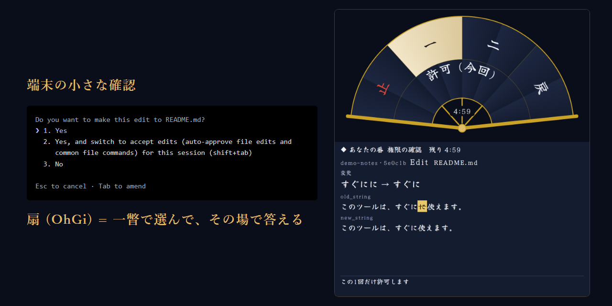

# BLEMMA

このプロジェクト「BLEMMA」は、Claude Code を使う人の「確認に戻る手間」を、一瞥で選べる扇 (OhGi) に変える道具です。

Claude は作業の区切りで、次の一手を選択肢にして差し出します。権限の確認 (この操作をしてよいかの問い)・Claude の質問・MCP の問い (外部の道具からの問い) が同じ 1 枚の扇に出ます。既定はマウスで、羽根を 1 回押すと選び、同じ羽根を 1.5 秒以内にもう 1 回押すと決まります。ダブルクリックでも同じです。

Claude Code 本体は改造しません。公式の仕掛け (hooks) と MCP の問いかけ (elicitation) を使います。



動画 (2 分 31 秒・YouTube): https://youtu.be/Ovf8C1icSXg

BLEMMA はギリシャ語の βλέμμα (まなざし・一瞥) です。扇 (おうぎ・OhGi) は、画面の隅の小さな窓に選択肢を折り扇の羽根として開く見え方の名前です。[Built with Claude: Japan 2026](https://cerebralvalley.ai/e/built-with-claude-japan2026) のために作りました。

## テーマと、誰のためのものか

テーマ 2「本来、誰にでも届くべきものを。」に応えます。BLEMMA が取り払う壁は**操作の壁**です。

Claude Code は仕事の途中で何度も確認を求めます。確認は端末の小さな選択肢で、矢印キーと Enter で答えます。MCP の問いの form では、矢印キーと Space と Enter で 5 回の打鍵でした (作り手の実測・Claude Code v2.1.318)。

作り手は視線で PC を操作し、OS の視線の道具からクリックを送ります。細い 1 行を目で狙うのは難しく、答えるまで仕事は進みません。BLEMMA はその確認を、画面の隅の扇に変えました。見つめて押す・視線で文章を送る・視線の点・スイッチの走査は、すべて既定で切です。見つめるだけで押したい人は、設定か `--set dwell=1` で 1 秒の注視を有効にできます。OS がクリックを送る時は `dwell=0` のまま使えます。

同じ壁は、端末から目を離して働く人の前にもあります。文書やブラウザを見ている間に Claude が確認を待っていて、端末へ戻って初めて気づきます。扇は画面の隅の小さな窓なので、確認が来たら一瞥して、その場で答えられます。片手で使う人にも、同じ入口が届きます。

## 5 分で試す

必要なもの: Python 3.10 以上 (試験は 3.10 と 3.13 で通しています)・ログイン済みの Claude Code (`claude` が端末から打てること)・Chrome か Edge (小さな窓に使います。無い時と、mac / Linux で Python の tkinter が無い時は、既定のブラウザのタブで開きます。画面の無い Linux では開けません = `docs/design.md` §5.7)。扇はマウスで試せます。Windows は `python` か `py`、mac / Linux は `python3` と打ちます (以下の `python` は読み替えてください)。

1. 取得します (zip で展開した時は、出来たフォルダー (`blemma-main` など) が次の手順の `blemma` に当たります)。

   ```
   git clone https://github.com/xxGodLiuxx/blemma
   ```

2. まずは取得したフォルダーで起動します。

   ```
   cd blemma
   python blemma.py
   ```

   **こう見えれば成功:** 画面の右下に小さな窓が開き、扇が横向きに閉じて控えます。ポインタを載せると状態の字が出ます。同じ端末で Claude Code が起き、初回はフォルダーの信頼の確認が端末に出るので、そこで答えます。通常のブラウザで開いた場合、窓の大きさは変わりません。

3. Claude に「次の一手を 3 つ、ask_board で出して」と頼みます (`ask_board` は同梱の道具の名前です。そのまま打てば通じます)。Claude Code へ引数を渡す時は、`python blemma.py -- --continue` のように `--` の後ろに書きます (`--settings` だけは BLEMMA が使うので渡せません)。

   **こう見えれば成功:** 窓が元の位置と大きさ (既定 640×720) に戻り、上に扇、下の和紙に問いが出ます。羽根には 一 二 三… が出ます (「ここで止める」が無ければ自動で足されます)。ポインタを羽根に載せると、全文が扇の内側の帯に出ます。読むだけでは決まりません。答えたい羽根をダブルクリックするか、1 回押してから同じ羽根を 1.5 秒以内にもう 1 回押してください。帯が「取り消す (3)」に変わり、3 秒後に端末へ答えが返ります。猶予の間は、その帯を 1 回押せば取り消せます。

4. 「README.md の『5 分で試す』を『5 分で試してみる』に直して」のように、ファイルを 1 か所直す頼みをします。

   **こう見えれば成功:** 確認が必要な Edit なら、変更の札が出ます。短い変更なら和紙の先頭に出る「変更」の行と、本文の印 (消す所は打ち消し線・足す所は下線) を読んでください。羽根の 一 にポインタを載せ、「許可 (今回)」を確認してから 2 回押すと、3 秒の猶予の後に Edit が進みます。取り消す時は内側の帯を 1 回押します。すでに許可済みの編集では、確認は出ません。

終える時は Claude Code を `/exit` で閉じます。扇を動かしている PC の中の小さなサーバー (以下「板」) も、`blemma.py` が起こしたものなら一緒に止まります。端末の窓やタブを ✕ で閉じた時は後始末が走らず、板と小窓が残るので、`python blemma.py --stop` で止めます。同じ所に置いた `blemma.py` を 2 つ以上の端末で動かしている時は、扇は 1 枚のままで (2 つ目は新しい窓を開きません)、どの端末の札も同じ扇に出ます。2 つ目に付けた設定 (`--set`・`BLEMMA_OPTS`・`--large` / `--small`・窓の大きさと位置) は効かず、開いている扇のままです。変える時は、扇の窓を閉じてから設定を付けて起こし直すか、窓の歯車で替えます (歯車はキーかクリックで押します)。板は最後の 1 つが終わる時に止まります。`--keep-board` で残した板と、手で起こした板 (`python board/server.py`) は止まりません。止める時は `python blemma.py --stop` です。板との切断を検知して 10 秒続くと、アプリの小窓も閉じます。別の作業フォルダーで使う時は、そこで `python <blemma を置いた所>/blemma.py` を実行します。

大きなボタンの見え方で使う時は `python blemma.py --large` です (小窓ではなく、既定のブラウザのタブで開きます)。扇を 1 回押しで決めたい時は、設定の「押し方」か `--set click=single` で変えられます。キーの数字 1〜6・有効にした視線・スイッチは 1 回で決まり、取り消しの猶予は同じです。ただし数字か、焦点の上の Enter / Space で「次から訊かない」を押す時だけは、同じキーを 1.5 秒以内にもう 1 回押して決めます (端末を見ながら打った数字や、端末の癖で打った ↓↓Enter で、恒久の許可を書かないため)。

## 読む・窓を整える

- 窓の縁をドラッグすると、扇・和紙・字が大きさに追従します。横長にすると左に問い、右に扇が並びます。扇の背景をドラッグすると小窓を動かせます。
- 長い文章は「▼ 続き」にポインタを載せると 0.35 秒後に 1 画面分進み、その後は 1.5 秒ごとに送ります。ボタンを押すか、↓ ↑ PageDown PageUp でも送れます。本文を読んでいる間は動きません。次の札・次の問いは先頭から表示します (取り消して戻った時は、読んでいた所のまま)。
- 和紙にポインタを載せるとコピーのボタンが現れます。`C` キーでもコピーできます。
- 窓の歯車で、字体 (`face`: 佑字 粛・明朝・ゴシック)・文字の大きさ (`font`: 5 段階)・配色を選べます。暗い配色では和紙も夜の色になります。位置 (`pos`) は画面の 4 隅から選べます。
- 「常に手前」は Windows では今の小窓をそのまま固定します。他の OS では、対応ブラウザの Document Picture-in-Picture で画面に収まる大きさの窓を開きます。
- 透過 (`--set clear=on`) は既定で切の Windows 専用の設定です。全体倍率が `scale=1` の時、扇の外の角だけを窓から切り、待機中は題の帯も隠します。対象の窓が見つからない時、同じ板の小窓を 2 枚開いている時、頁を拡大・縮小している時は、窓を切りません。

設定の値と操作の一覧は [`board/README.md`](board/README.md) にあります。

## うまくいかない時

| 起きる事 | 意味と、どうするか |
|---|---|
| 扇に何も出ず、端末に確認が出た | 正常です。板が動いていない・窓を閉じた・待ち時間 (既定 5 分・扇の要の上に残りの時間) を過ぎた時は、いつもの確認に戻ります |
| 権限の確認が扇に出ない | Claude Code の auto mode では権限の確認そのものが出ません。`blemma.py` は `--permission-mode default` (端末の帯に「manual mode on」) で起こします。帯が「auto mode on」なら、途中で mode を替えています |
| 文字で答える問いや計画の承認が扇に出ない | 扇が答えるのは選ぶ問いだけです。自由記述と計画の承認は端末で答えます |
| `blemma.py` が「claude が見つかりません」と出して終わった | `claude` が見つからないので、板も窓も開かずに止まりました (`claude` が shell の alias だけで動く端末でも、こう出ます。その時は次の手順を使います)。`claude` が動く端末で、もう一度 `python blemma.py` を実行します。別の端末で Claude Code を起こす時は、`python board/server.py` で板を起こします (頁が開き、その端末の Ctrl+C で止まります。開くのは大きなボタンの板 = `--large` と同じ見え方で、扇で使う時は、開いた頁の住所の `#t=` の前に `?mode=small` を足して開き直します)。Claude Code を起こす端末で `python blemma.py --print-only` を実行し、表示された 1 行を打ちます |
| 「板を起動できません (ポート・配置を確認)」と出る | その番号 (既定 8765) を他のものが使っています。`python <blemma を置いた所>/blemma.py --port 8766` のように別の番号で起こします。前に残した板が動いている時は、`python blemma.py --stop` で止めてから起こし直せます。`board/state` を先に消していた時は、別の番号で起こすか、残った python の process を止めます |
| 端末が止まって見える (行に「BLEMMA: 板 (ブラウザ) で答えを待っています」) | 扇が答えを待っています。扇で答えるか、右の親骨「戻」でいつもの確認に戻します。小窓が他の窓の裏に居る時は、手前に出してください。端末の Esc は作業ごと止めます |
| 「板の起動が時間切れです」と出る | もう一度起こします (初回や、ウイルス対策の走査で起動が遅い時に出ます) |
| 「起動処理に失敗しました (配置・権限を確認)」と出る | 書き込めるフォルダーに置いてください (`board/state/` に起動の記録などを書きます) |
| 「名簿の錠が取れません」か「名簿の錠が取れないため、板を止めずに残しました」と出る | 別の端末の `blemma.py` が、板を使い始めるか終える途中でした。起こす時に出たら、板も Claude Code も起こさずに止まっています。少し待ってから起こし直します (ほかに `blemma.py` が動いていないのに、起こし直しても続く時は、`board/state/clients/.lock` を消します)。終わる時に出たら、板は止めずに残っています。`python blemma.py --stop` で止めます (この後に起こした回が、最後の 1 つとして終わる時にも止まります) |
| 「名簿 (board/state/clients) に書けないため、名簿を使わずに続けます」と出る | 起こし方の名簿の置き場に書けません (前に別のユーザーで起こして作られた・読み取り専用の置き場・錠の pid を書けない)。そのまま使えますが、終わる時に止めるのは、この回が起こした板だけです (使い回した板は残る = `python blemma.py --stop` で止めます)。置き場を自分のユーザーで書ける所にすると、いつもの動きに戻ります |
| 「引数を確認してください (--help)」と出る | Claude Code へ渡す引数は `--` の後ろに書きます (例 `python blemma.py -- --continue`) |
| 「頁の設定の名を確認してください: …」と出る | `--set` の鍵の打ち間違いです (例 `dwel` → `dwell`)。鍵の一覧は [`board/README.md`](board/README.md) にあります |
| 「頁の設定の値を確認してください: …」と出る | `dwell`・`scan`・`key` の値が、扇の受ける範囲の外です (例 `scan=12` → `0.5`〜`10` か `off`。`BLEMMA_OPTS` の値も同じ)。範囲は [`board/README.md`](board/README.md) にあります |
| 「Python 3.10 以上で実行してください」と出る | 古い Python で起こしています。`python3 --version` (Windows は `py --version`) で版を確かめ、3.10 以上で起こします |
| 「ブラウザを開けません」と出る | BLEMMA は、その PC でブラウザを開ける環境で使います。SSH の先・画面の無い Linux・WSL では確かめていません |
| 「--settings は -- の後ろに渡せません」と出る | BLEMMA は自分の設定を `--settings` で渡します。hooks などは `.claude/settings.json` に書きます |
| 「この 1 行は今の出力先の文字コードで書けません」と出る | `--print-only` の 1 行を pipe や file へ向けた時 (`\| Set-Clipboard`・`> line.txt`) に、その文字コードで書けない字 (é など) がありました。向けずに console に表示して写します |
| 端末で答えたのに、扇に札が残る | 権限の確認を端末で「許可」した時、扇の札は待ち時間 (既定 5 分) まで残り、次の札 (質問を含む) はその後ろで待ちます。右の親骨「戻」で閉じてください。端末で答えることが多い時は、先に `python board/server.py --no-browser --perm-wait 120` で板を起こしてから `python blemma.py` を実行すると、権限の札は出てから 2 分で閉じます (手で起こした板は `python blemma.py --stop` で止めます) |
| mac / Linux で、小窓でなく通常のタブで開いた | Python の tkinter が無く、画面の寸法が取れません。`python3 -c "import tkinter"` で確かめ、tk を入れる (配布元の手順で) か、`python3 blemma.py --window-position 1200,600` のように位置を渡すと小窓で開きます |
| 小窓に ERR_UNSAFE_PORT と出る | その番号はブラウザが開きません (6000・6665〜6669・10080 など)。`--port 8766` のように別の番号で起こし直します |
| 2 つ目の端末で起こしても、窓が増えない | 正常です。扇は 1 枚で、どの端末の札も同じ扇に出ます。2 つ目に付けた `--set` などの設定は効かず、開いている扇のままです (変える時は、扇の窓を閉じてから設定を付けて起こし直すか、窓の歯車で替えます)。扇が見当たらない時は、開いている板の頁を閉じてから起こし直します |
| 窓に「板の server に繋がりません」と出る、または小窓が閉じた | 板との切断が 10 秒続くとアプリの小窓は閉じます (頁を読み込む前に板が止まった時は残るので、手で閉じます)。`blemma.py` を起こし直してください。その間の確認は端末に出ます |
| 作業を全部止めたい | 権限の確認の「作業を止める」か、端末の Esc です。質問の「この質問に答えない」と MCP の「この問い合わせを閉じる」は、その問いを閉じるだけです |

## 安心の 3 行

- **勝手に許可しません。** 人が押した時だけ答えを返します。時間切れと異常は判断なしです。
- **板が無い時は、いつもの Claude Code です。** 確認を受ける仕掛けは何も返さず、端末のいつもの確認に戻ります。
- **外のサービスへ自動では送りません。** 板は 127.0.0.1 だけで待ち受け、起動ごとの token で守ります。token を置く `board/state` は、今のユーザーだけが読めるようにします (絞れない置き場 = exFAT・FAT32・ACL を変えられない共有では、警告が出るのは板を手で起こした時だけです。そこには置かないでください)。ブラウザの起動行には token つきの URL が載るので、複数の人が同時にログインして使う機械は想定していません。同じユーザーで動く他のプログラムは token を読めるので、それらからは守れません。板が強制終了などで後始末なしに消えた後、同じ PC の別のユーザーのプログラムが同じポートを先に取ると、hook はそれを板と見なします (これも複数の人が使う機械の話で、想定の外です)。記録は選択と時刻と数だけで、問いの本文は残しません。あなたの `settings.json` は書き換えません。hooks と同梱の MCP server は、あなたのユーザーの権限で動く Python です (入れる前に `hooks/` と `mcp/` を読めます)。

## BLEMMA の 3 点

1. **先回り** — Claude が作業の区切りで、次の一手を 2〜6 択で差し出します (同梱の MCP の道具 `ask_board`。使い方の芯は MCP server が Claude に伝えます。細かな作法は手順 [`skills/board/SKILL.md`](skills/board/SKILL.md) にあり、`~/.claude/skills/board/` へ写すと skill として読まれます)。区切りごとに Claude に訊き返させる使い方でも、その場で選んで答えられます。Claude 自身が迷った時に訊く `AskUserQuestion` (2〜4 択) も同じ扇に出ます。板が無い時、`ask_board` の選択肢はいつもの確認に出ます。
2. **選ぶ問いは全部 1 枚で** — 権限の確認・Claude の質問・MCP の問いが、同じ扇に同じ形で出ます。
3. **マウス・視線・スイッチで押せる** — 既定はマウスの 2 回押し。必要なら、見つめて押す機能やスイッチの走査を設定で入れられます。決めた後 3 秒は取り消せます。「止」(止める側) と「戻」(いつもの確認に戻る) は親骨の左右で動きません。札が替わった瞬間・ボタンの並ぶ列が送られた直後・上の行 (待ちの件数・「繋がりません」) の出入りでボタンの列がずれた直後・設定を閉じた直後・ボタンを押したままの間 (ドラッグ中) とドラッグを離した直後は、注視で押されません。札が替わった直後の 0.4 秒は、キー・スイッチ・クリックの押しも数えません。窓がキーの焦点を得た直後の 0.4 秒も、キーとスイッチの押しは数えず、スイッチの走査は 1 こまぶん何も光らせません (別の窓へ向けて打ったキーが、扇の「許可」に当たりません)。焦点の上の Enter / Space・クリック・触る・スイッチで札の中の画面を進めた直後も同じです (前に出ていた画面へ向けた、0.4 秒の内の遅れた 1 押しや、続けて入った 2 打目が、新しく出た画面に当たりません。数字のキーは続けて打てます。数字や注視で進めた直後の 0.4 秒は、Enter / Space・クリック・触る・スイッチを数えません (数字のキーと取り消しは別です)。猶予を 0.8 秒より短くした板では、取り消しは猶予の半分から押せます)。キーの焦点をボタンに置いたまま、答える前に札が替わった時 (時間切れ・ほかの窓からの答え) は、次の札のどこにも焦点を置きません (前の札へ向けた Enter が、次の札の「許可」に当たりません。その札に自分で答えるか、札の中を進めると、次からは元どおり先頭に置きます)。読み上げの「押す」や音声操作のクリックも、1 回の押しとして受けます。全文を読む内側の帯は押せず、確定後の猶予の間だけ「取り消す (n)」のボタンになります。

質問を小窓に集める道具や、携帯から承認する道具は先にあります。BLEMMA の芯は、Claude が次の一手を差し出す所と、3 種の問いを視線とスイッチで押せる 1 枚にまとめた所です。

## 携帯から答えたい時

板は PC の中だけで動きます。携帯から Claude Code を動かす道としては、公式の [Remote Control](https://code.claude.com/docs/en/remote-control) があります。BLEMMA の板を携帯に出すものではありません。大きな板の頁の「携帯で開く」は、利用者が自分で用意した転送で同じ頁を開くための補助です (提出版では確かめていません。token が転送の先へ渡ります)。

## しくみ (開発者向け)

公式の hooks 6 本 + 同梱の MCP server 1 つ + 127.0.0.1 だけの小さな板 (HTTP・Python の標準ライブラリだけ)。

| Claude Code の入口 | hook | 扇に出るもの | 返すもの |
|---|---|---|---|
| 権限の確認 | `PermissionRequest` | 道具と入力の要点・許可 (今回)・次から訊かない・拒否・作業を止める・端末で答える | `decision.behavior` |
| Claude の質問 (`AskUserQuestion`) | `PreToolUse` | 2〜4 択 | `allow` + `updatedInput` |
| MCP の問い (elicitation) | `Elicitation` | 選択肢・はい / いいえ | `action` |
| 次の一手 | 同梱の MCP server `blemma` の道具 `ask_board` | 2〜6 択・頭に「次の一手 (Claude の先回り)」 | elicitation の答え |
| 待ちの合図 | `Notification` | 帯と縁で知らせる (扇の表示では札がある間と、その直後 1.5 秒は出さない) | 何も返さない |
| 作業の状態 | `UserPromptSubmit`・`Stop` | 印 = 作業中・あなたの番・完了 | 何も返さない |

- 設定は起動時に `--settings` と `--mcp-config` で渡すだけで、あなたの `settings.json` は書き換えません。書くのは repo の `board/state/` だけです (起動の記録・日ごとの数の記録・生成した設定 2 本・小窓専用のブラウザの profile・起こし方の名簿)。消す時は、`python blemma.py --stop` で板を止めてから `board/state` ごと消して構いません (板が動いたまま消すと、`--stop` が板を見つけられません)。
- `ask_board` は subagent の中からも扇に出ます (Claude Code v2.1.318 で確かめました)。subagent の名はカードに出ません (Claude Code がその情報を渡さないため)。
- 板で 2 分を超えて考えても、答えは届きます。Claude Code は主の会話の MCP の呼び出しが 2 分を過ぎると裏の task へ移しますが、v2.1.319 では `ask_board` の答えを板で待つ間は移さず、答えを受けてから続きを書きます (2026-11-07 に 133 秒で確かめました。版を上げた時は確かめ直してください)。
- 答えが無いまま待ち時間を過ぎた時、hook は判断を返さずに終わります。線と細目は [`docs/design.md`](docs/design.md) に書きました。
- 扇に載るのは 1 画面で 1 つを選ぶ問いだけです。複数選択・2 問以上・7 択以上は、同じ窓の縦の一覧に切り替わります。羽根の外の「断る」は MCP の問いの補助のボタンです。
- 手元で試した OS は Windows だけです。mac と Linux は確かめていません。画面の無い Linux (SSH の先) では頁を開けないので、`--print-only` と手で起こす板 (`python board/server.py --no-browser`) を使います (`docs/design.md` §5.7)。mac / Linux で右下の小窓になるのは、画面の寸法が取れる時 (Python の tkinter がある時) です。取れない時は、既定のブラウザのタブで開きます。Windows で `--print-only` が表示する 1 行は、PowerShell 用の書き方です。
- tkinter を入れられない時は `python3 blemma.py --window-position X,Y` (例 `1200,600`) で位置を渡すと、Chrome / Edge の小窓で開きます。
- 提出版で直さずに残した制限は [`docs/design.md` §5.7](docs/design.md#57-知っていて残した制限) に並べました。
- Windows の「常に手前」は `POST /window` → `board/window_win.py` → 標準ライブラリの `ctypes` で既存の小窓を固定します。触るのはその板の小窓 1 枚だけです (既定でないポートの板は、窓の名にポート番号が付きます)。対象の窓が見つからない時・固定に失敗した時と他の OS では、対応ブラウザの Document Picture-in-Picture を使います。
- 11/7 の自動試験の記録は 648 本・skip 0。実ブラウザの試験も含みます。代用品に差し替えている経路と実機での確認範囲は [`docs/design.md` §7.3](docs/design.md#73-試験と検収) に記載しています。

## この後

作り手は提出の後も、毎日の Claude Code の仕事でこの扇を使います。選択肢の中身は Claude が作るので、モデルが良くなるほど先回りの中身も良くなります。扇の側は変えません。次に確かめるのは、mac / Linux での動きと、読み上げを使う人の通り道です。

使ってみた人の声は、視線・スイッチ・片手の順に優先して反映します。

## 作り方

Claude Code を開発の中心に置きました。

- 設計の文書 (`docs/design.md`) を正本にして、実装は部品ごとの依頼書に分け、Claude Code の subagent と別の LLM の agent に並列で任せました。主催の資料の読み取りと計画の反証は、Claude Code の dynamic workflow で回しました (全部で 82 体 = 読み手 7・反証 72・束ねと書き出し 3)。
- 実機の確かめを実装の初日 (11/4) に置きました。hook の欄名と挙動を公式 doc と実の `claude` (v2.1.318) で測り、結果を設計 §10.3 に残しました。この確かめで、auto mode (v2.1.318 時点の既定) では権限の確認が出ないことが分かり、起動の 1 行に `--permission-mode default` を入れました。
- 外部のレビュー (別の LLM による反証) を、設計の前後と実装の後に入れました。tkinter の小窓へ全面で転換する案は、このレビューの反証を受けて「同じ頁の小型の見え方」に変えました。実装の後のレビューでは、自動の試験が全部通っているコードに、線を破る道が 3 つ見つかりました (待ちの期限・注視の数え直し・通知の仕掛けの実行環境)。反例の試験を足して直し、足した試験が直す前のコードで落ちる事を確かめました。
- 出荷の code を実の Claude Code に挟んで 15 の経路を検収しました。板なし・時限・見る頁なし・端末で先に答えた時のどれでも、勝手に続行した例はありません。
- 仕上げでは、4 つの持ち場 (頁・板・hook と MCP・起こし方と文書) に読むだけの反証役を置き、重い所見は別の検証役に確かめさせました。所見は鵜呑みにせず、実測で採否を決めました (検証役が「確定」とした 1 件は、実の窓と実のブラウザで 3 通り測って再現せず、退けました)。3 巡目と 4 巡目の直しの差分は、読むだけの 3 つの視点と、所見ごとの独立の反証役 (全部で 9 体) が調べ、21 件の所見が出ました。採った直しは、直しを 1 件ずつ外した木で見張りの試験が落ちる事まで確かめています (ほかの守りと重なる念のための数行は、試験を置かない物として [`docs/design.md` §16](docs/design.md#16-116-の検収と扇の記録-2026-11-06) に分けて書きました)。実の窓の稽古では、表示倍率 150% の画面で扇を運ぶたびに窓が 1 画素ずつ大きくなる、という試験では出ない不具合も見つけて直しました。

## 期間前に書いた文書について

`docs/` の設計の文書 (`design.md`・`research_official_docs.md`) は、ハッカソンの開始 (2026-11-02 12:00 JST) より前の 2026-10-14〜11-01 に書いたものです。開始前には code を 1 行も書いていません。BLEMMA の実装・試験・実行用の設定は、2026-11-02 12:00 JST 以後に新しく作りました。この repo の git の記録で区別できます。最初の commit (tag `pre-event-docs`) が期間前の文書の区切りで、実装は以後の履歴に入っています (以後の履歴には文書の直しも含みます)。期間前の文書を含めることは、主催者に事前に確認しました (2026-11-01)。

## License

MIT (see LICENSE). 扇の字体 Yuji Syuku は SIL Open Font License 1.1 で同梱しています (`board/static/YujiSyuku-OFL.txt`)。

---

## In short (EN)

Demo video (2:31, YouTube): https://youtu.be/Ovf8C1icSXg

**BLEMMA** (Greek βλέμμα, "a glance") turns the moments when Claude Code stops to ask you into OhGi, a small folding fan you can check at a glance. Claude also offers the next step as choices. Permission prompts, Claude's own questions and MCP elicitations land on the same fan. Free text still goes to the terminal. Claude Code itself is not modified: BLEMMA uses only the official hooks and MCP elicitation.

**Theme 2: "What should reach everyone, by right."** The wall is the operation wall: a small terminal prompt that wants arrow keys and Enter (an MCP form took 5 keystrokes in our measurement). The maker operates the PC with eye gaze and sends clicks through the OS gaze tools. Mouse input is the default; dwell, gaze scrolling, the pointer trail and switch scanning are off. Enable dwell in Settings or with `--set dwell=1` to press by looking for one second. Keep `dwell=0` when the OS sends clicks.

**Try it in 5 minutes.** Python 3.10+ (tests pass on 3.10 and 3.13), a logged-in Claude Code, and Chrome or Edge. Clone the repo, run `cd blemma` and `python blemma.py` (`python3` on macOS and Linux), then ask Claude: "Offer three next steps with ask_board". The app window waits with a closed fan, then returns to its full size (640×720 by default), with the fan above the question on washi paper. Hover over a blade to read its full text on the inner band. Click once to select, then click the same blade again within 1.5 seconds to confirm; a double-click also works. The answer is sent after a 3-second undo window. Click the inner Undo band once to cancel. Use `--set click=single` for one-click confirmation or `--large` for the big-button board (it opens in a normal tab of your default browser). On macOS/Linux without tkinter the app window falls back to a normal tab; pass `--window-position X,Y` to get the app window. A Linux box without a display cannot open a tab at all: use `--print-only` with a hand-started board (`python board/server.py --no-browser`). If you answered a permission prompt in the terminal, its card stays on the fan until the wait time (5 minutes by default) and later cards queue behind it: close it with the Back rib, or start the board first with `python board/server.py --no-browser --perm-wait 120` so permission cards close two minutes after they appear (stop that board with `python blemma.py --stop`). Closing the terminal window itself (or losing the SSH session) skips the cleanup: the board and the app window stay up until `python blemma.py --stop`.

**Safety.** Never auto-allows: only a human press returns an answer; timeouts and errors return no decision. Without the board you get the normal Claude Code prompt. The board listens on 127.0.0.1 only, with a per-launch token kept in a folder only the current user can read (where that cannot be enforced, such as exFAT/FAT32 drives or shares with fixed ACLs, only a hand-started board warns: do not put BLEMMA there), logs only the choice, the time and counts, and never edits your `settings.json`. It is not meant for machines that several people are logged in to at once, and other programs running as the same user can read the token. If the board dies without cleaning up and another user's program takes the same port first, the hooks treat it as the board; shared machines are out of scope. The hooks and the bundled MCP server are Python that runs with your user's rights; you can read `hooks/` and `mcp/` before installing. BLEMMA starts Claude Code with `--permission-mode default`; in auto mode there is no permission prompt to show.

**Three points.** (1) Pre-emptive choices with the bundled MCP tool `ask_board` (the MCP server tells Claude how to use it; the fuller guide is the skill under `skills/board/`, which you can copy to `~/.claude/skills/board/`). (2) One surface for every selectable question. (3) Mouse input with optional gaze and switch input, a 3-second undo period, and fixed stop and return blades (Japanese: 止 / 戻; English: Esc / 0). The reading band cannot be pressed until it becomes the Undo target during that period. Keys, enabled dwell and switches confirm in one action, except that on "Don't ask again" (a permanent rule) a number key, or Enter or Space on the focused button, takes the same key twice within 1.5 seconds. For 0.4 seconds after a card changes, no key, switch or click is counted; for 0.4 seconds after the window gets the key focus, no key or switch press is counted and switch scanning stays dark for one step, so a key meant for another window cannot land on Allow; the same holds after Enter or Space on the focused button, a click, a touch or a switch moves to another screen inside a card, so a press that comes late within those 0.4 seconds, or a doubled press, cannot land on the new screen (number keys can still follow each other; right behind a step made by a number key or by dwell, Enter, Space, clicks, touches and the switch are not counted, while number keys and Undo are; with an undo period shorter than 0.8 seconds, Undo can be pressed from half of that period). If a card gives way to the next one before you answer it (a timeout, or an answer from another window) while the key focus rests on one of its buttons, the next card gets no key focus, so an Enter meant for the old card cannot land on Allow; once you answer that card or move on inside it yourself, the usual focus comes back. Clicks from screen readers and voice control count as one press. Taking over two minutes on the board is fine: in Claude Code v2.1.319, an `ask_board` call waiting on the board is not moved to a background task, and Claude continues with your answer (checked at 133 s on 2026-11-07; re-check after upgrading).

**Reading and windows.** Resize the window to resize the fan, paper and text; wide windows put the question on the left. Drag the fan background to move the app window. Hover over More for 0.35 seconds to start paging, then every 1.5 seconds; clicking or ↓ ↑ PageDown PageUp also works. Reading the paper does not move it. Hover to reveal Copy, or press C. Settings offer three typefaces, five text sizes, paper-aware colors and four corner positions. Windows pins the existing app window; other OSes use supported Document Picture-in-Picture windows sized to the screen. Optional `clear=on` cuts only the corners outside the fan on Windows at `scale=1`, and hides the title bar while idle. It does nothing if no matching window is found. Two terminals share one fan (settings given to the second one, such as --set, BLEMMA_OPTS, --large/--small and the window size or position, do not change the open fan), and the board stops when the last one exits (`python blemma.py --stop` stops a board you kept). The app window closes after a detected board disconnection persists for 10 seconds. Nov 7 test record: 648 passed, 0 skipped, including the real-browser test; see the design document for substituted paths that still need manual checks.

**Phone.** The board stays on your PC. To reach Claude Code from a phone, see the official [Remote Control](https://code.claude.com/docs/en/remote-control). The "Open on a phone" button of the big board only helps with forwarding you set up yourself (untested in this version; the token travels with it).

**Pre-event documents.** The design documents under `docs/` were written before the hackathon (Oct 14 – Nov 1, 2026). No code existed before Nov 2, 12:00 JST. All code, tests and config were created after the start, and the git history keeps them apart: the first commit, tagged `pre-event-docs`, is the documents-only baseline. Including these documents was confirmed with the organizers beforehand (Nov 1, 2026).

Tested on Windows only. MIT.

---

JaH — https://github.com/xxGodLiuxx
